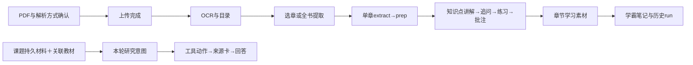

# Mentrix 功能复核 v0.3

日期：2026-11-16。范围：当前公开浏览器构建的功能、状态与产物消费链，以及协调者本轮只读浏览器见证。旧[v0.2](Mentrix-浏览器端逆向报告-v0.2.md)保留为历史，本版补深与纠偏。**仍是部分功能逆向，不是服务端源码恢复、完整产品等价或所有功能运行通过。** 私有账号、教材标题/页数/ID、会话与原始捕获不进入公开资料。

## 证据与覆盖限制

当前入口引用的[公开主脚本](https://mentrix.cn/assets/index-rKI-61y3.js)已无凭据GET，2,979,827bytes；SHA256 `a46069288fd0841733d470ca5510fdb463e1dcd70458e44b1e2edcb62eecf541`，取回2026-11-16T13:57:17.400Z，与历史一致；不证明所有账户/配置行为相同。

本版区分：**静态**＝公开代码实际调用/消费；**协调者观察**＝当前真实浏览器只读动作；**本地适配**＝独立副本的实现；**待证/拟议**＝未运行或将来工作。各类证据不能互相替代。

REA这次分析了两个完整声明选择集，未重新扩大分析全bundle：

| 选择集 | 实际结果 | Evidence ID |
|---|---|---|
| 学习产品128声明/138,257bytes | parsed=1、parse_failures=0；语义partial/truncated，20,000节点 | `ev_8bafa133a2f375c3fd9dedb89eba2b64078a39481b3d938a19d3bd3b057d57d7` |
| 上传处理148声明/128,059bytes | parsed=1、parse_failures=0；语义partial/truncated，20,000节点 | `ev_0270db60b2ffba5a0323d1da7644948a4f4dbc128e4fc6bffd244759d6f0b808` |

CLI均exit0，调用/数据流仍有未知，不能称全应用语义完成；初次写出因输出目录缺失失败，创建目录后重试成功；失败详情保留在工具执行记录中，不计为成功证据。内部索引为run `MENTRIX-REA-REAUDIT-20261116` 的R01、R02的18项feature-ledger、REA compact-summary；R03核过R01的148声明/154片段hash与坐标。原始脚本、私有捕获和审计目录不公开。

R03固定12族94问题：P0=66、P1=22、P2=6，涵盖上传、处理、章节、教学、会话、练习、研究、图谱、产物、阅读、资料库与门槛。**尚未逐条给运行完成率**，不能称“94项全过”或旧报告“0/94”。旧认证/练习/批注/TTS分析仍有价值，主要不足是深度不均和动作证据缺失。

完整调用、状态与边界见[上传与章节处理深追](behavior/上传与章节处理深追.md)、[学习阅读与研究工具深追](behavior/学习阅读与研究工具深追.md)和[94问清单](behavior/功能覆盖94问.csv)。清单中的未回答状态保持原样，不能把问题数当作已实现数。

## 核心流程：先分清对象和准备门

图为静态恢复的产品序列；新上传、生成、研究和下载本轮未执行。教材、课题材料、会话临时图片、知识点讲义、章节artifact不是同一个对象。

下文 `B[a,b)` 是原bundle从0开始、末端不含的UTF-8字节；压缩函数名只对本hash有效。

## 上传、处理与章节准备

**静态链**：`yZe→pYe/kre→xZe→Sre→PYe→IYe/DYe/ao→Pat`。上传前检查教材数量配额，读取本地PDF页数作报价估计，弹窗默认分章节：先目录、想学哪章再准备；全书模式则目录后自动处理所有章，第一章完成即可先学。TOC/full报价各有loading/error/retry/余额不足。默认文案300MB/3000页；组件中出现页数文案不等于服务器限制已执行。

直传使用`filename/size_bytes/extraction_mode/client_upload_id`申请凭证，OSS分片有checkpoint/续签，随后complete确认；仅特定传输异常回退multipart。上传事件是milestone/oss_done/complete/error。进度显示混合传输百分比、秒计时与里程碑，不能称真实OCR页级百分比。hook在卸载/新上传时能abort，未见同等明确的用户“取消上传”按钮。

`Pat`分pending/ocr/extracting/completed/failed/unavailable。OCR的`partial`被客户端视为可接续目录，并不代表每页都有文字；重试、404与不可重试分别处理。TOC的process_step展示工具活动，流失败改轮询；离页abort流没有证明后台TOC已取消。

按章批处理另有`JDe→quote→KDe→AIe→gJ`，只选未解析且不busy章节，去重章号后报价/确认。queued/dispatched/failed/skipped_credits/no_content分别消费；取消有独立请求，部分完成后的服务器保留策略仍未知。

单章面板`zie`：未提取默认`stages:['extract','prep']`，已提取只`['prep']`；GET flow/quote与POST flow分开。`Jh`消费snapshot/stage/entry/run并核flow_id，45秒无事件触发重连，5次退避后可detached。可展开过程、收起、离页接续；POST cancel才取消服务任务。extract取消文案说清理半成品，prep取消可继续；这是客户端告知，实际清理未验。完成文案是“知识点和讲义都已生成”，不是“总结完成”。

定位：`Sre` B[1935716,1940261)、`PYe` B[1945090,1947788)、`Pat` B[2728802,2734240)、`JDe` B[1178861,1180216)、`zie` B[2396204,2398933)、`Jh` B[857035,861099)。当前prep费用须以真实quote为准；bundle公告含“不再扣积分”，不从旧“按需付费”文案推固定收费。

## 图鉴、教学顺序与知识点阅读

knowledgeGraph实际消费`points/edges/chapter_titles`；point含中英文名、chapter、页段、difficulty、prerequisites，edge用from/to。`vf`按章分组，统计难度和任一端属于本章的边数，故“依赖数”包括跨章关联。章节卡展开是知识点卡/列表，显示前置数量和页段，不能把端点名自动翻译成自由节点图编辑器。

`fDe→eJ→G1.getChapterPlan`消费`teaching_sequence:[{kp_id,order}]`。推荐顺序按order，教材顺序按page_start；后端如何推前置关系、如何选教学顺序、排序效果是否更好仍未知。当前本地仅book→chapter→KP包含关系的图鉴是独立缩减，不能称原先修语义等价。

`Yit→Git→kit`依URL的kp/prep/view=atlas切换。知识点先有章plan准备门，再有“开始学习”门，已有讲义后进阅读/练习。`ua`以`kp_id/action:start|ask/user_message`发teach流，消费queued/queued_started/text_delta/done/error及过程/搜索来源。`pit`把讲义、历史追问、本轮回答、前后导航放在同一阅读列；ask保留讲义，后接对话。不是通用聊天替代课程。

阅读还有跨章前后导航、三种语言风格、折叠侧栏和滚动恢复。`XJe`等内容可读再恢复，批注深链/流式优先，wheel/touch可打断；设备流畅度未验。定位：`vf` B[1146971,1147837)、`fDe` B[1162211,1165401)、`kit` B[2565540,2570862)、`pit` B[2558179,2560727)、`XJe` B[2423852,2425066)。

**纠正v0.2路由分类**：`/textbook/:textbookId/qa→Zit`只显示“答疑功能已迁移到课题工作坊”，不是现行全书聊天页。Zit B[2590293,2591074)。`read_kp_detail`的“精读”是研究工具结果卡，也不能凭标签再造独立精读页面。

## 练习、批注与章节成果

练习配置`Rtt`基于讲义与划重点，题目语言zh/en、总数1–5、选择/简答配比；quote与生成参数分别消费。`jnt/ks`组织逐题草稿、作答/重试、grading、反馈、修订重交与历史题集。当前本地整套题提交、单题型是可用适配，未等价恢复原逐题/混合题型节奏。保留本项目更严格的显式reveal门，不为追求相似降低答案隔离。Rtt B[2465827,2469834)、jnt B[2507595,2509265)。

`HJe/OJe/Fie`按讲义/会话/练习区块保存exact、前后文、位置、颜色；便携本按KP/章节归组并回原文。当前固定持久ID、版本stale与答案门应保留；改成贴近选区的小浮层和随身本属于下一UI实施。HJe B[2420171,2421347)、OJe B[2416217,2416572)。

**个性化总结实际链**：`Ght→Uht→SIe/l3e→ld→gft`。章主页显示已学KP/总KP、追问轮、划重点、批注作为素材；未准备禁用，低素材有确认，再选语言。run阶段为read_materials/write_note/validate_repair/package_offline；前端识别这些阶段不证明后端实际每步执行。

最新artifact与历史run分开，只有success且has_content的run可读/下载；`Xht`用sandbox iframe的srcDoc展示HTML纸面，`koe`下载artifact或固定run blob。它与普通知识点讲解、当前本地goal+notes+attempt指纹总结均不同。定位：Ght B[2935554,2939102)、Uht B[2929866,2934140)、gft B[2953415,2954970)。实际HTML内容、修复效果、历史下载文件本轮未打开验收，不能称离线产物完整恢复。

## 课题研究：必须消费工具证据

持久材料走`aJ` multipart，创建课题后`eIe`串行上传；失败尝试删新课题，但清理成功未知。预览按PDF/图/MD分型，材料可重命名/删除/手动OCR。材料≤100页、md≤5MB为客户端约束/文案；静态100MB与配置fallback30MB有冲突，服务器现行值待证。`$dt`有定时模拟进度和文件名over100遗留拒绝分支，不当真实页数/OCR测量。

临时图片另走`Mut→GAe/qAe→/conversations/:id/inline-images`凭证/OSS/complete，不能混作持久材料。图片成功上传不等于已验证视觉问答。

`Lut`支持@材料、拖入chips、粘贴/拖图；pending上传禁发。本轮“关联知识库/联网研究”互斥，强制search_kp_hybrid或web_research，发送/换会话后复位。`xh`流区分消息、item、tool_step、moderation、aborted、标题更新；工具过程按tool_call_id聚合，历史卡读取持久process_steps。

`Vct/Hct/wct`展示材料页/行范围及删除状态、KP搜索命中/搜索教材数/partial/失败范围、精读结果、读教材页段。`ioe`把research过程、sources_for_citation和完整报告分折叠；来源卡为实际URL/标题链接，未知工具也可展开原始output。只保留最终Markdown会丢掉重要用户证据。定位：eIe B[1136187,1137014)、tdt B[2845569,2848980)、Lut B[2824937,2829317)、xh B[902590,908869)、ioe B[2784425,2787283)。检索/联网算法、供应商和真实搜索成功仍未知。

## 协调者真实浏览器：只给具体动作记账

本轮已观察书架→教材→图鉴章卡，难度分段条与侧栏难度条；展开可见双语KP/页段/前置数量；侧栏进入**既有讲义**，可见底部追问、练习、导出、字号与便携本；章主页有四类素材统计与未生成学霸笔记卡。这些为协调者当前只读见证，R01/R02/R03未查看或公开私人正文/账户捕获。

本轮未生成、上传、作答、联网、付费或下载产物。入口可见不算成功，既有讲义不算本轮生成，C/D/H/I整族不打勾；统计公式、来源集合、教学效果未验。本地Mock浏览器检查不计原站运行完成数。

## 当前独立副本与下一步

| 本地已有、独立适配 | 实质缺口/下一轮拟议 |
|---|---|
| 本地账号、来源属主与版本、JSON持久任务/取消/预算 | 保留这些边界；原站认证/队列/扣费后台未恢复 |
| PDF/OCR、人工章结构、讲解/追问/练习/四类批注 | 章节准备门、连续阅读、可恢复滚动与逐题节奏需重做UI |
| 目录包含图 | 加实际来源支持的难度/先修/推荐序须新合同与审阅，不画假语义图 |
| 个人trace总结、MD/离线HTML | 本章素材可见、独立成果reader/历史run体验；原学霸笔记不是同物 |
| 课题关联教材与关键词检索、真实页码/coverage | 富材料/视觉/强制工具/联网timeline尚缺，不能用假搜索卡充数 |
| 教学任务包、学生/教师分版和理解/复盘记录 | 用户要求的差异化功能，不倒灌成Mentrix的prep事实 |

UI先修容器身份、焦点、选区和滚动，再加轻motion。主操作按“准备→阅读→练习→笔记→章成果”组织，管理/设置收进次级操作。没有真实增量事件就显示任务状态，不造流或研究步骤。

后续逐项核入口、输入/消费输出、终态、刷新、失败/取消、来源与产物；新生成/收费须明确范围及自编材料。当前只读见证不能代签，未答项保留partial。
