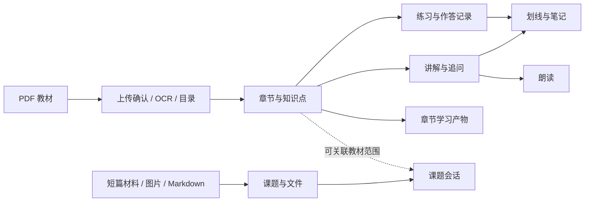

> 公开整理版：移除本机绝对路径。下文的 evidence/ 与 REA Evidence ID 指向本地原始审计资料，未随公开仓库上传；不包含账号会话、第三方原始脚本或可运行的 Mentrix 克隆。

# Mentrix 浏览器端逆向报告 v0.2

核验日期：2026-11-16（Asia/Shanghai）。范围：当前交付的浏览器代码、用户授权登录后的只读页面、公开配置接口。原 EVI-X 工程保持只读，所有资料位于独立目录 `<本机工作目录>/Mentrix-REA逆向2026`。

**已经取得完整生产主 JS，并恢复页面路由、主要客户端接口、状态处理、学习流程和视觉规则。登录态已实际使用。服务端源代码、数据库、模型和私有提示词没有被恢复；AI 生成、文件上传、付费、批注写入等执行效果也没有被冒充为测试通过。**

本报告替代 v0.1 中“主脚本尚未取得、只能看登录页”的当前状态；v0.1 保留为历史记录。这是一份内部逆向资料，不是竞赛作品，也不是可运行的全站克隆。

## 1. 证据与方法

| 编号 | 已获得的材料 | 能支持的结论与限制 |
|---|---|---|
| E01 | 首次 REA 临时浏览器捕获 `evidence/rea/home-evidence.json` | 登录入口的 DOM、截图与网络事务；整体 producer coverage 为 incomplete |
| E02 | 主脚本 `corpus-source/mentrix/public-bundle/index-rKI-61y3.js` | 2,979,827 bytes，SHA-256 `a46069288fd0841733d470ca5510fdb463e1dcd70458e44b1e2edcb62eecf541`；一次无凭据公开 GET 取得 HTTP 200 |
| E03 | REA 业务片段分析及映射 `evidence/rea/static-bundle/` | 96 条完整语法声明、65,656 bytes 的选择范围已解析；不表示整个应用语义已恢复 |
| E04 | 两次登录后 TinyFish 只读检查的去敏派生记录 `evidence/tinyfish/` | 登录态与部分页面/表单的代理观察；没有可独立重看的 DOM/截图工件，存在地址和页面描述冲突，不能无条件照抄 |
| E05 | 公开 HTTP 响应 `evidence/public-api/public-config.json` | 无 Cookie/Bearer 的 GET `/api/v1/config/public`，HTTP 200，取得当前公开配置 |
| E06 | 双角色静态分析和独立复核 `.collab/handoffs/`、`.collab/reviews/` | 路由、API、行为规则与冲突排查；不是后端运行测试 |

本轮使用独立 Node 24.22.1 与 REA 6.9.0 CLI，没有改动原工程依赖或 Codex MCP 配置。网页在线检查由 TinyFish 使用用户保存的会话完成；静态代码分析由 REA 和本地解析器完成，二者来源分别标记。

全量 2.98 MB bundle 的 REA 分析触及 1,536 MiB 分析器堆限制，实际 parsed=0/skipped=1。虽然 CLI 返回 0，不能称为成功完成全量 AST。之后按完整语法声明抽取业务片段，保留原始字节范围和 hash；片段分析 parsed=1、syntax complete，但 application=partial、semantic=unknown。完整失败与片段成功两份证据均保留，没有反复提高内存或隐去 unknown。

主要 REA 原始 Evidence ID：

- 登录入口：`ev_e1072b5f6ef6af60942ff5e95d87bd9aa45c54a3edf64ad4923c983d23cfcda0`。
- 全 bundle 的 partial：`ev_60b37397aea75971ae80cf92815d242878433eb52abda24b6da2a31c19807070`。
- 业务片段：`ev_fa8e08a361e9f5ca3ad0b14033c98562f30513706751b2466ae3b9ca0820f6be`。

## 2. 产品结构：教材学习与课题研究两条主线

代码与页面共同指向的产品组织方式是：长篇 PDF 教材先变成可导航的章节/知识点，再进入讲解、追问、练习和笔记；短篇讲义、题目、图片或 Markdown 放入课题，围绕材料展开对话和研究。两种资料入口的处理、阅读与聊天组件有连接，但不是同一个上传表单。

图中连线主要表示客户端存在的流程与数据联系，不是本次已经运行成功的端到端处理链。OCR、讲解质量、实际学习效果和导出文件正确性尚未执行验收。

## 3. 前端技术与运行边界

| 项目 | 交付代码中的事实 |
|---|---|
| UI | react-dom 自声明版本 19.2.3；Chakra/Emotion 样式系统、Lucide 图标；其他包版本未逐一确认 |
| 路由 | React Router 体系，生产表 `vft` 与路由构造器绑定；不是原 EVI-X 的 Next 路由结构 |
| 构建 | Vite 风格环境配置，`MODE: production`、`SSR: false`、同源 API 基地址 `/api/v1` |
| 客户端状态 | Zustand store/persist；查询缓存、生成状态、练习草稿分别管理 |
| 文档呈现 | PDF 层、Markdown/数学公式样式、章节和知识点阅读界面 |
| 常规网络 | Axios 式封装、JSON、120 秒超时、`withCredentials: true`、请求拦截器 |
| 长任务 | 自定义 fetch/ReadableStream、SSE、部分 EventSource、AbortController；不能假定它们全部走同一拦截器 |
| 文件 | 客户端存在 OSS 临时凭证、SDK 与分片上传适配；未读取或使用实际上传凭证 |

这些证据不支持确定服务端语言、数据库种类、队列、云上拓扑、向量数据库或模型服务商。前端工具名中出现检索和网页研究，只能证明客户端识别这些事件或工具，不能据此认定其后端算法。

## 4. 恢复的路由表

生产表中有 24 项显式配置，含兜底 `*` 和两项常量展开；这不是“24 个页面均已在线测试”的声明。逐项源位置见 `evidence/rea/static-bundle/route-table.csv`。

| 分组 | 路径 |
|---|---|
| 认证 | `/login`、`/register`、`/forgot-password` |
| 协议 | `/terms`、`/privacy`、`/payment-terms` |
| 预览 | `/preview/preparation` |
| 工作台 | `/`、`/upload`、`/statistics`、`/settings`、`/membership`、`/payment/return`、`/feedback` |
| 教材 | `/textbooks`、`/textbook/:textbookId`、`/textbook/:textbookId/extraction` |
| 章节 | `/textbook/:textbookId/chapters/:chapterNum`、`/textbook/:textbookId/chapters/:chapterNum/artifacts/:artifactType` |
| 教材问答 | `/textbook/:textbookId/qa` |
| 课题 | `/workshops`、`/workshops/new`、`/workshops/:wid` |
| 兜底 | `*` |

在线代理早期报告给出的 `/my_course`、`/user_info`、`/upload_course` 不在此生产表，不能作为现行路由事实；第二轮所报 `/textbooks/{id}/detail` 也与源码的单数 `/textbook/:textbookId` 不一致，已隔离。章节正确参数是 `chapters/:chapterNum`，不能沿用调查提示中未经源码确认的 `chapter/:chapterId`。

本构建的 `/workshops` 与 `/` 共同渲染 `E$` 页面，因此工作坊入口包含首页模块并不构成冲突；`/statistics` 绑定另一个组件，需分别核验。

## 5. 认证：已有完整客户端契约，尚无新的认证抓包

登录界面默认密码模式，另有短信验证码入口；手机号输入仅留数字并截为最多 11 位，验证码最多 6 位；提交可用性还受协议勾选、输入状态和 loading 控制。密码登录、短信登录、注册、忘记密码均有独立调用。

常规 API 请求从状态库取 access token，附加 Bearer；部分认证与公开配置 URL 在不附 Bearer 的名单中。`auth-storage` 的 persist 代码保存 accessToken/user/expiresAt/isAuthenticated 到 localStorage，存在提前 30 秒的过期判断。本调查没有读取真实 localStorage 值。

401 分支合并并发刷新，刷新成功后仅重放一次原请求；本构建的 refresh 无显式请求体，客户端期望 `success` 与 `data.access_token / expires_in`。503 分支有有限重试。自定义 SSE/fetch 是否覆盖相同策略需逐条看代码，不能把拦截器规则概括到全部网络请求。

首次 REA 真实捕获曾见 `POST /api/v1/auth/refresh` 返回 HTTP 200，但当时响应体未保留。现在的刷新字段是从主 JS 读出的客户端期望，不是那次响应已被补回。refresh Cookie 的 HttpOnly/SameSite 属性、服务端校验与跨设备行为仍未知。

## 6. 教材：上传、结构化处理、目录与章节任务

客户端链路可恢复为：选 PDF → 校验 → 申请上传会话/临时凭证 → 分片直传 → 完成确认 → OCR 状态 → 目录检测/确认 → 知识点提取或章节 flow → 进入学习。调用侧字段含 `filename / size_bytes / extraction_mode / client_upload_id`。

核心接口族（均补 `/api/v1` 前缀）：

- `/textbooks` 及单本详情、布局、文件夹相关操作。
- `/textbooks/upload-credentials`、`/textbooks/:id/complete`、上传事件流。
- `/textbooks/:id/ocr`、`ocr/retry`、目录自动检测和 agent/toc。
- `/textbooks/:id/agent/knowledge-graph` 及 status。
- `/textbooks/:id/chapters/:num/flow`、`flow/quote`、`flow/cancel`、`flow/stream`。

章节 flow 允许 `ocr/extract/prep` 等阶段，客户端支持估价、排队/处理中状态、进度、取消和失败反馈。看到取消接口不表示任意时点都能撤销服务端已完成工作，复现时必须把取消请求与服务端最终状态分开。

PDF 类型判断支持 MIME 或 `.pdf` 后缀；体积上限代码为 300 MiB。上传组件默认 `maxPages=3e3` 并渲染“不超过3,000页”，因此 3,000 页已有源码与界面报告支持，属于展示规则；当前文件校验函数没有本地数页逻辑，服务端强制边界未验证。代码另有损坏、加密、无法读取、页数超限、会话失效等错误分支。

## 7. 知识点讲解、追问与练习

教材视图按章节和知识点组织，客户端有章节 context/plan、知识点 lesson/conversation/metadata。lesson 按文本接收，202/204 被处理为暂未就绪，不能当作成功获得讲解。讲解通过流式事件逐步呈现，包含队列、文本增量、过程步骤、审核后重新生成、结束和错误等状态。

讲解风格是账户级偏好 `teaching_prompt_style`：

| 值 | 客户端声明的含义 |
|---|---|
| `default` | 中文为主，关键概念可附英文 |
| `language_adaptive` | 中文讲述，专业术语保留原始英文，减少翻译切换 |
| `english` | 全英文讲解，简明表达并对齐相关英文课程术语 |

保存到用户资料后全教材通用；“选择风格”和“按新风格重新生成”是不同操作。代码在保存失败时阻止触发重新生成，复现时应保持这个先后关系。

练习客户端覆盖 quote、生成、sets、取消、恢复、作答 attempts、答案 reveal、反馈 flag 与答案 key。quote 查询用 `mc/exp`；生成 body 为 `language/requested_mc/requested_exp`，不能把估价参数直接当作生成请求体。准确字段、枚举和 UI 对应见独立 API 契约报告；练习草稿有本地持久化，不能据此推断答题结果仅在本地。

本轮没有触发讲解、练习或评分，因而没有形成真实模型输出或正确率评测。完整功能验收还需要明确测试输入、成功/失败响应、扣费前后与刷新恢复行为。

## 8. 章节产物、导出与工作坊对话

章节 artifacts 的客户端流程展示四阶段：`read_materials → write_note → validate_repair → package_offline`。存在列表、内容、生成、过程流和下载；内容按 text、下载按 blob 接收。教材导出另有异步 job、active、状态、download、cancel，不能把“出现下载按钮”当成已得到有效文件。

课题对象即 workshop，具有文件和会话，客户端存在创建、详情、修改、删除、文件预览/OCR、conversation 列表与创建。创建会话使用 `container_type=workshop`、`api_format=response_api`；会话字段出现 title/persona/is_deleted。课题 persona 与讲解风格不是同一个偏好系统，已见 `default/exercise_explainer`。

对话有消息流、重新生成、取消、内联图片及直传/回退适配；过程 UI 能识别 `search_kp_hybrid / read_kp_detail / read_textbook / web_research / read_web_pdf` 等工具名。这些是客户端识别的工具名称，不是其服务端实现或真实执行质量的证据。

## 9. 批注、朗读与阅读体验

批注并非只存一个易失的 DOM 坐标。客户端使用所选 `exact` 文本、前后各约 32 个字符，以及同文第几次出现的 `position_hint`。来源还区分对话消息或练习 set/qid/block/attempt 等，支持多色、笔记和跳回。它提供了重定位线索，但文稿改写、重复段落或截断后不保证恢复；不能承诺跨版本零丢失。

TTS 先按段落、句号、空格等切块，切块目标 3,000、总长 30,000 的计数采用 JavaScript 字符串 `.length`，不是自然语言“字数”。3,000 不是每段的绝对上界，某些非 text 片段不再拆分。实现包含下一块预取、30 秒请求 deadline、页面隐藏时暂停、同 audio 实例恢复；stop 会 abortAll 并清空。不能把它说成跨刷新或跨设备的持久断点续播，也未确定 TTS 服务商。

阅读视觉采用森林绿与米白/木色；标题 Playfair Display/LXGW WenKai，正文 Lora/LXGW WenKai，数学与 PDF 有独立呈现层。浅色背景 `#FAF9F6`、深色背景 `#131C17`；panel `#FFFFFF/#1B2820`，主文字 `#1A1A1A/#EAEFEA`。登录卡片最大宽 420 px、圆角 16 px，输入高 48 px；具体源位置见 bundle-analysis.md。

## 10. 当前文件限制与文案冲突

| 项目 | 已确定的来源与口径 | 限制 |
|---|---|---|
| 教材文件 | PDF；客户端最大 300 MiB，组件展示不超过 3,000 页 | 未实际上传或验证服务端拒绝行为；本地校验没有数页逻辑 |
| 课题材料格式 | PDF/JPG/PNG/Markdown | MIME/后缀的完整判断见 API 契约报告 |
| 课题非 Markdown 文件 | 公开配置 `workshop_material_max_mb=30`，客户端配置驱动，fallback=30 | 当前配置指向 30 MiB；另有 100 MB 文案，不能采用文案覆盖校验逻辑 |
| 课题 Markdown | 客户端单独限制 5 MiB | `.md/.markdown` 与 MIME 分支需保留，不等于所有纯文本都可上传 |
| 课题 PDF 页数 | 有 100 页的 UI/服务端错误契约 | 没有通过边界上传验证该限制 |
| 课题材料数量 | 当前公开配置 `workshop_material_max_count=10` | 是当前公开配置，不是全产品永久常数 |

本次公开配置还返回 `closed_beta=false` 和若干邀请/升级提示开关；`version=1.0.0` 是该响应字段，不等于所有前端包或服务端组件的版本。

## 11. 配额、会员与支持模块

客户端有用户 quota、membership skus/topup/credit-coefficients、orders、积分不足/每日上限/功能未解锁/已有任务等分支；另有公告、反馈、反馈回复、邀请与活动埋点。前端能据错误码显示配额弹窗，但后端原子扣费、退款、订单回调、账本和任务锁均未恢复。

在线界面报告的当前账户余额已去除，不作为通用赠送权益；也不把静态 fallback 套餐或代理叙述的价格当作已核验报价。反向理解这些模块时，核心是授权和资源门槛如何进入状态机，而不是复用对方商业条款。

## 12. API 清单的正确计数方式

文本模式提取获得 121 个 `_e.get/post/put/patch/delete` 匹配点、117 个去重 method+路径表达式；独立 AST 分析枚举到 123 个调用点，其中 79 个模板、42 个字符串和 2 个标识符首参。后两项是动态上传 `_e.post(a,i,...)` 和资源 `_e.get(e,...)`，文本模式没有覆盖。它们是调用点计数，**不是 121/123 个已实测 API**，其中动态资源调用也不能直接算作一个固定业务 API。SSE、自定义 fetch、OSS、内联图片等另有入口。

具体字段、路径模板和源位置分别查：

- `.collab/handoffs/api-contracts.md`：独立 API 与行为契约分析。
- `evidence/rea/static-bundle/endpoint-candidates.csv`：有明确语法范围的文本候选。
- `evidence/rea/static-bundle/textual-candidates.json`：候选上下文与字节位置。
- `evidence/rea/static-bundle/claim-source-locations.json`：主要技术主张位置。

不要将文本候选、客户端期望响应、代理看到的界面、真实 HTTP 响应合成同一个“接口已通过”标签。

## 13. 可恢复的数据概念，不是数据库 DDL

从路由、请求和读字段可以组织出以下前端概念：User/Auth/Preferences；Quota/Membership/Order；Textbook/Folder/UploadSession/OCR/TOC；Chapter/KnowledgePoint/Lesson/Conversation；ExerciseSet/Attempt/AnswerReveal；ChapterArtifact/ExportJob；Highlight/NoteAnchor；Workshop/Material/Conversation/Message；TTS chunk/config；Announcement/Feedback。

这些关系足以指导独立前端和兼容 API 分层，但字段类型、唯一约束、索引、删除级联、事务、授权过滤和生产存储不可由此自动推出。另附的《独立复现规格》将这些设计选择明确标为 proposed，不使用“已恢复原数据库”的表述。

## 14. 在线观察的接受与隔离

登录后的首页、教材入口、上传与课题表单、设置/会员等界面已由浏览器代理实际访问并报告。对与主 JS 一致的结构和选项，可作为交叉证据。两轮结果中的以下部分没有升级为已确定规格：

1. 无源码对应的旧路径，以及不一致的教材详情 URL。
2. `/statistics` 两轮内容描述互相冲突，第二轮像首页，无法据此恢复精确统计布局。
3. 没有返回 screenshot URL 或 DOM 工件，不能把文字报告称为已归档截图或像素验收。
4. 页数、套餐、账户数值和数量统计若未与代码/响应对齐，继续保留未知；账户身份与材料名称已去除。

这属于记录和审查证据质量，不代表登录失败。保存的登录态已正常用于两次运行。

## 15. 本轮已完成与尚未完成

| 范围 | 结果 |
|---|---|
| 完整公开主 JS、本次来源与字节身份 | 已完成 |
| 生产路由、主要 API 调用侧契约、关键客户端行为 | 已完成有范围的梳理，逐项可查源位置 |
| REA 调用与字节映射复核 | 已完成；全量资源限制和语义 unknown 保留 |
| 登录后只读盘点 | 已完成两轮，冲突项隔离；不是全部状态验收 |
| 可运行独立应用 | 尚未实现；本轮交付的是逆向资料与复现规格 |
| 上传、AI生成、评分、批注保存、TTS播放、导出、支付的真实运行 | 未执行，不声明通过 |
| 原始 TSX/工程目录与全部源文件命名 | 未恢复；bundle 不是原始开发工程 |
| 服务端源代码、私有提示词、模型/数据库 | 未取得，不能从浏览器直接恢复 |

原项目最初选定的 603 个源码文件已做哈希对照，先前检查均未变；最终打包前再做同范围复核。该核验不代表遍历所有被忽略的私有运行数据。

## 16. 下一步

这份资料已能用于决定哪些能力放进参赛副本，以及按什么接口边界独立实现。若后续进入实际复现，应先冻结有限场景，再实现独立后端和测试数据：教材→章节→知识点→讲解→练习/反馈；课题作为另一条独立流程。生成、扣费、上传等未知状态需在明确测试范围下定向验证，不能用这份静态分析代替真实验收。

当前主责 captain `/root`；独立静态生产 `/root/architecture`，接口与一致性复核 `/root/reverse_critic`。当前控制状态 intake；未运行竞赛最终提交交付，不签发竞赛 Go。

outcome: partial（浏览器端结构与调用侧规格已整理；完整产品执行覆盖和服务端恢复未完成）
