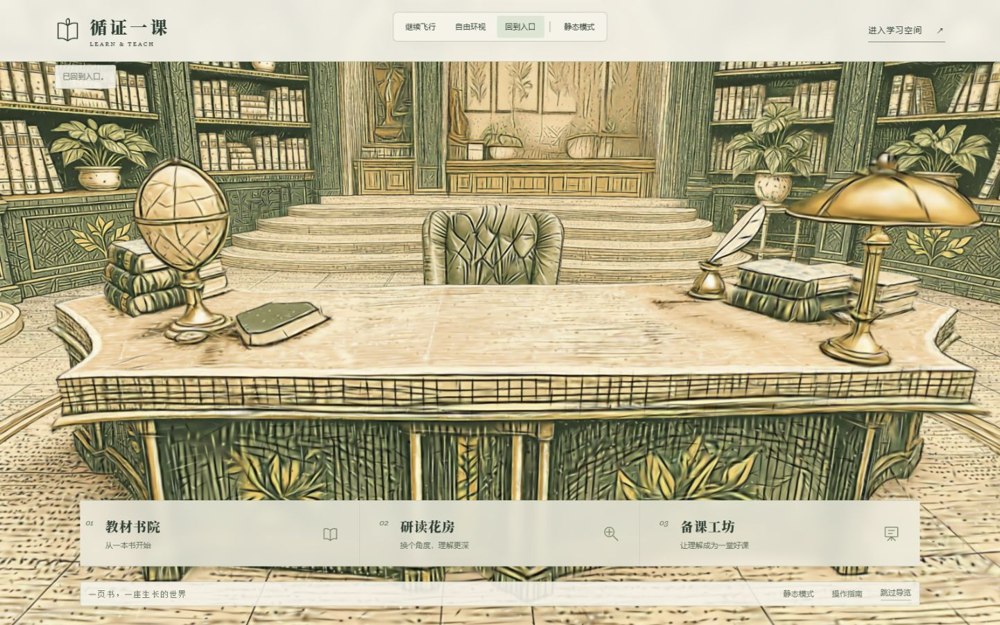

# 书籍花园欢迎页：当前集成状态

独立 `/welcome` 前导页，品牌为“循证一课 / LEARN & TEACH”，不替换原门户或学习客户端。页面使用纸白、森林绿与鼠尾草绿；真实主题图 `/assets/world/book-garden/source.png` 已到位并作为静态poster，图片缺失时保留原生SVG书院。三个学习入口始终是正常链接：`/study#/textbooks`、`/study#/research`、`/study#/teaching`。

## 已实现与尚待验证

已接入静态首屏、显式开始漫游、SPZ头部预检、真实SPZ加载与`SplatMesh.initialized`等待、导览路径、OrbitControls环视缩放、暂停、回到入口、静态模式、键盘及减少动态。进入学习或跳过不依赖3D。没有有效场景清单或资源未完成时保持静态序章，不会显示“3D已加载”。

主题原画由imagegen生成。当前世界重建使用三轮Atlas生成后保留的12帧；最初seed因壁面结构冲突被剔除，未纳入此次精修输入。精修操作`e8a4883592054646bc20a7cdf7f75e18`已完成，原始SPZ为2,000,000点、31,427,137字节，SHA256为`0dc4f0f6b10ce47a1aa169d79b4e3190aacf954d2b906072644d6128e8d92131`。本地完整解码和浏览器实际三维渲染已通过，未改写生成文件。开发期素材生成与浏览器运行分开：欢迎页不包含API key，不向Atlas发送请求，也没有统计上报或跨站资源请求。

真实浏览器已观察到静态桌面与390px窄屏无横向溢出，以及完整54秒导览到达终点、键盘环视/缩放、平滑继续、暂停、回入口、静态释放画布并重新载入。当前公开场景使用三张固定学习入口卡片；不启用缺少真实遮挡判断的物体贴附热点。触屏真机、低端设备和公网部署仍待验证。

## 已接入的服务与资源

1. `welcome.html`、`welcome.js`、`welcome-spz.js`、`welcome.css`已加入根静态白名单；`/welcome`和`/welcome/`均映射到`/welcome.html`。现有`/`、`/study`路由保留。
2. `/assets/**`使用现有静态服务；`.spz`按`application/octet-stream`提供，Three与Spark的JS按`text/javascript`提供。页面先加载独立`BookGardenSpz`检查器，再启动欢迎页客户端。
3. 仅欢迎页响应启用Spark内嵌WASM与Blob worker所需策略，未全站放宽：

```text
Content-Security-Policy: default-src 'none'; script-src 'self' 'wasm-unsafe-eval'; worker-src 'self' blob:; connect-src 'self'; img-src 'self' data:; style-src 'self'; font-src 'self'; base-uri 'none'; object-src 'none'; frame-ancestors 'none'
```

无需 importmap 或内联 JS；裸模块引用已在本地 vendoring 时改为相对路径。不需要 `'unsafe-eval'`、外部 CDN、React、打包重构或跨源隔离。CSS 的细微纸纹为自包含 SVG data URL。字体复用已有 Adobe 思源宋体 Heavy 与其现有授权：`/assets/ui/fonts/SourceHanSerifCN-Heavy.otf`。

## 场景清单与相机

实际配置见[scene.json](../assets/world/book-garden/scene.json)，素材来源、哈希与技术复核见[provenance.json](../assets/world/book-garden/provenance.json)。当前为RUB/Y-up，场景变换为单位变换，相机垂直FOV约55.98度，9个节点组成54秒导览。各直段作smoothstep插值；结束后停在终点，时间节点等分，不宣称与几何草案的非等分时间锚点完全相同。

清单并发读取复用同一请求，限32000字节与12秒，切静态或销毁会取消。图片/SPZ仅接受指定本站目录的本地路径，拒绝远程URL、查询串、编码和父级路径。清单最多24个节点、15–120秒；所有相机节点和导览直段都验证外层bounds与书桌exclusion。手动相机也验证上一安全位置到新位置的整段，避免大幅输入穿过保留框。

继续导览时，在256份采样中寻找可安全直线接入的路径点，以0.6–3秒平滑回接。没有安全接入点就保留环视并提示回入口；不会直接跳回旧进度。回入口显式重置相机、安全位置和旧惯性。上述约束是基于估计区域的AABB，不是mesh碰撞；不保证所有枝叶、薄面和未重建空间都可任意穿行。当前不开放走出主房间的平移自由飞行。

`hotspots`为`[]`；三个正常学习链接固定在叠加卡片中，不依赖三维投影或虚假的遮挡判断。

## SPZ进入GPU前的检查

页面取得压缩文件后，先`await BookGardenSpz.inspectSpz(bytes,{signal,maxPoints:2000000})`，通过后才导入GPU模块、创建渲染器。当前仅接受gzip容器的SPZ v1–3；点数必须为1至2000000，且受本页已验证的SH0–3、flags0/1及坐标精度范围约束。另仅对实际验证的v2/SH0/fractionalBits12组合兼容flags64/65，并保留原flags、ignoredFlags64与compatProfile。Niantic没有为0x40定义业务语义；固定Spark2.4解码器忽略该位，两个独立CPU探针完整解码原样文件为200万点，未清除标记或以转码文件替代原件。0x02扩展、0x80 LoD及其混合仍不放行。明文v4/ZSTD、未知版本、未支持的球谐或扩展、点数超限、无解压能力及头部损坏均保持静态，不跳过检查。

检查器用`Blob.stream()`与`DecompressionStream('gzip')`取得16字节SPZ头部后即取消管道并释放reader，不收集全部解压属性。返回明确的`inspection: 'header-only'`和`integrityVerified: false`；这不验证整个gzip尾部CRC或全部点数据，最终Spark解码与渲染仍需失败回退。独立实现依据[Niantic官方格式及读取源代码](https://github.com/nianticlabs/spz/blob/d5abdee9b37c426a0b66b961c3d43b5857a24f4f/src/cc/load-spz.cc)，未把上游无点数硬限制的默认行为作为本页预算。

## 控制、生命周期与预算

- 鼠标拖动与触屏单指环视、滚轮或双指缩放；OrbitControls禁用平移，保留清单中的距离范围，并通过上述估计AABB约束手动相机。
- 聚焦 canvas 后方向键环视，`+`/`-` 缩放，空格暂停/继续，Esc 返回静态。按钮提供暂停、环视、入口复位与静态替代；无需拖拽即可进入全部学习入口。
- `prefers-reduced-motion` 初次载入不会自动飞行，手动启用 3D 后仅环视；运行中开启该偏好立即回静态。节省流量模式保留静态画面。
- 载入时只报告实际已下载MiB，不使用计时假进度。SPZ压缩传输上限64MiB、头部点数上限200万、场景载入等待60秒、像素比最多1.5；这些不是对解码内存或GPU显存的硬上限，低端设备仍需真机核验。
- 连续观察 120 个有效帧间隔，超过 75 个大于 90ms 时返回静态；这是降级启发式，不是稳定帧率承诺。WebGL 不可用、context lost、渲染异常同样返回静态。
- 页面隐藏会暂停路径。静态切换或卸载取消网络、失效异步generation、停止渲染循环、清理控件/场景/渲染器/监听/观察器与worker所有者资源。部分构造的渲染器也进入幂等释放流程，不因Spark初始化失败而遗留GPU对象，也不重复释放。
- `pagehide`若进入BFCache只返回静态并释放world，保留按钮事件；返回缓存页后仍能重新开始。正常离页则完整销毁实例。未完成或过期资产不会变成已载入状态。

公开客户端接口：`window.BookGardenWelcome.install(...)`；页面自动建立 `window.bookGardenWelcome`，提供 `explore()`、`pause()`、`home()`、`staticMode()`、`dispose()`、`getState()`。状态含 `mode`、`loading`、`ready`、`hasManifest`、`classification: static-poster|3d-scene`。

## 固定依赖与核验

依照 [Spark 官方入门](https://sparkjs.dev/docs/)、[SplatMesh](https://sparkjs.dev/docs/splat-mesh/)、[SparkRenderer](https://sparkjs.dev/docs/spark-renderer/) 以及 [Three OrbitControls](https://threejs.org/docs/pages/OrbitControls.html) 实现。固定 `@sparkjsdev/spark@2.4.0`、`three@0.180.0`，均为 MIT；Spark metadata 的 peer 范围为 `three >=0.180.0`。

通过 npm registry 的 metadata/tarball 下载，校验完整 `dist.integrity` SHA-512 后，**仅提取**必要浏览器模块和许可证；未运行安装脚本。Spark 模块内嵌 WASM 与 Blob worker，因此需要上列专用 CSP。`assets/vendor/world/source.json` 记录 tarball URL、完整 integrity、原始文件 hash、修改后 hash、文件大小与仅本地 import 重写。生成脚本为 `.collab/ui20/world/client/vendor-world.py`。

`assets/vendor/world/package.json`已将该独立依赖目录标为private ES模块，未更改根包类型。

欢迎页、SPZ检查器与服务检查38项，加真实控制器数学的4项合成接线回归，共42项通过：

```text
node --test tests/welcome.test.cjs tests/welcome-spz.test.cjs tests/welcome-server.test.mjs tests/welcome-navigation-client.test.cjs
```

检查覆盖真实本地模块解析、清单单请求/传输限制/取消、部分构造释放、BFCache返回、实际SPZ头部在GPU前拒绝、合成gzip版本/点数/损坏与abort、手动相机AABB以及欢迎页专用CSP和私有静态隔离。它们使用合成场景和HTTP/DOM检查，不表示真实GPU或实际世界通过。

当前验收分开归因：静态桌面与390px无溢出、真实SPZ的本机浏览器画面和基本控制已观察；合成测试验证精确位置/生命周期约束，不能替代设备性能测试。没有帧率或显存基准，不保证所有设备流畅。当前浏览器有一条已完成编译的signed/unsigned shader警告，无观察到的渲染中断；触屏、弱设备与公网部署仍待验。




独立Chrome在原样SPZ上完成暂停、回入口、静态释放和重新打开，记录实际1442×902 CSS视口；截图未拉伸。该结果与另一浏览器的完整导览观察分开保存，不将请求的1586×992视口或canvas绘制缓冲当作实际CSS尺寸。
